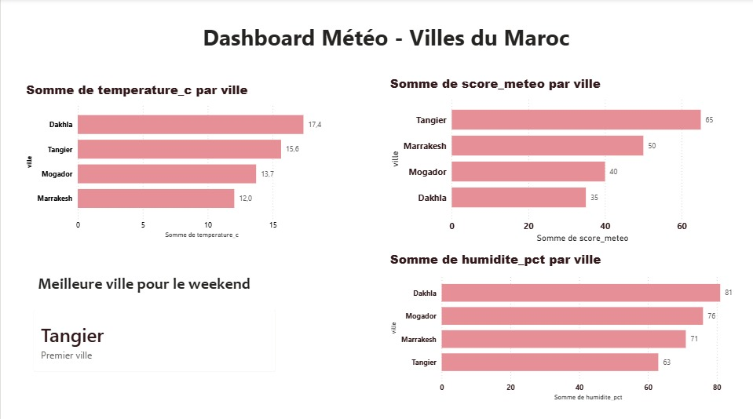

# Morocco Weather Medallion Pipeline

An ETL pipeline built on the **Medallion architecture** (Bronze → Silver → Gold) that collects real-time weather data for four Moroccan cities, scores each one out of 100, and ranks them to find the best weekend destination.



## Cities

Marrakech · Tanger · Dakhla · Essaouira

## Architecture

```
OpenWeatherMap API → BRONZE (raw JSON) → SILVER (cleaned) → GOLD (score + ranking) → Tests → Power BI
```

| Layer | Script | What it does |
|---|---|---|
| Bronze | `code/ingestion.py` | Calls the API for each city and stores the raw JSON, untouched, in MinIO, partitioned by city and date |
| Silver | `code/silver.py` | Selects useful fields, sets out-of-range values to null, converts UNIX timestamps to readable dates |
| Gold | `code/gold.py` | Computes the weather score out of 100, the city ranking and the best city |
| Quality | `code/tests.py` | Automated checks on each layer |

Storage is **MinIO** (S3-compatible, local), accessed with `boto3`.

## Weather score (out of 100)

| Criterion | Max points | Ideal range | Lower tiers |
|---|---|---|---|
| Temperature | 40 | 18–28 °C | 25 pts (15–32 °C), 10 pts (10–38 °C), else 0 |
| Humidity | 30 | 40–60 % | 20 pts (30–70 %), 10 pts (20–80 %), else 0 |
| Wind speed | 30 | < 5 m/s | 20 pts (5–10 m/s), 10 pts (10–15 m/s), else 0 |

The Gold layer adds `score_meteo`, `classement`, `meilleure_ville` and `date` to each record.

## Data quality checks

- **Bronze**: the raw JSON files exist for all four cities
- **Silver**: temperature in [-50, 60] °C, humidity in [0, 100] %, wind ≥ 0, timestamps present
- **Gold**: score in [0, 100], ranking present

## Example result (run of 12 April 2026)

| Rank | City | Score |
|---|---|---|
| 1 | Tanger | 65 / 100 |
| 2 | Marrakech | 59 / 100 |
| 3 | Essaouira | 40 / 100 |
| 4 | Dakhla | 35 / 100 |

This is a single-day snapshot, not a seasonal conclusion.

## Tech stack

Python · OpenWeatherMap API · MinIO · boto3 · Power BI

## Getting started

1. Start a local MinIO server and create three buckets: `bronze`, `silver`, `gold`.
2. Get a free API key at [openweathermap.org](https://openweathermap.org).
3. Install and configure:
   ```bash
   pip install -r requirements.txt
   cp .env.example .env     # then put your own OPENWEATHER_API_KEY in .env
   ```
4. Run the pipeline in order:
   ```bash
   python code/ingestion.py
   python code/silver.py
   python code/gold.py
   python code/tests.py
   ```

## Limitations and next steps

- Scoring thresholds and weights were chosen manually, not calibrated on user preferences
- Only temperature, humidity and wind are scored; precipitation and sunshine could be added
- More cities (Agadir, Fès, Rabat, Casablanca)
- JSON → Parquet for better performance at scale
- Scheduled daily execution with an orchestrator such as Airflow, and email alerts on failure

## Author

Chaymae Yassine, AI & Data Engineering student at EMSI Rabat · 
